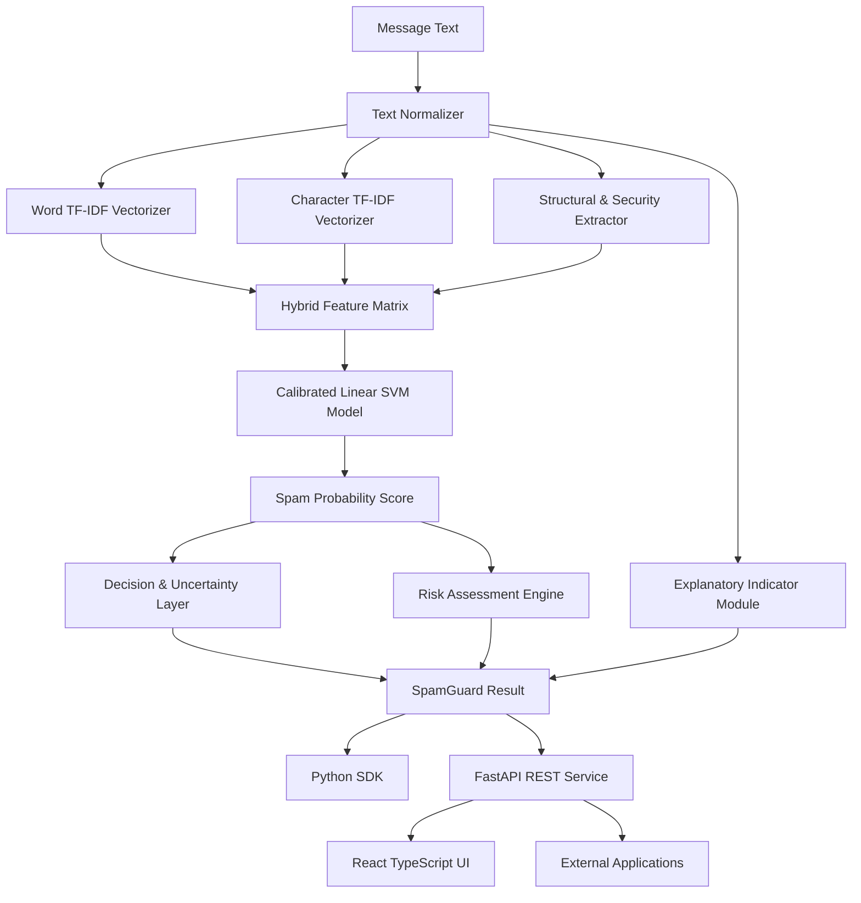

# SPAMGUARD AI

## Reusable Hybrid NLP Spam Detection Engine, REST API, Python SDK & Web Application

[](https://www.python.org/)
[](LICENSE)
[](https://fastapi.tiangolo.com/)
[](https://reactjs.org/)
[](https://scikit-learn.org/)

---

## 1. Project Overview

**SpamGuard AI** is a production-style, reusable Natural Language Processing (NLP) text classification engine engineered to detect spam, phishing, and suspicious messages across multiple input mediums (SMS, Email, Chat, Notification streams, Web Contact Forms, and Support Tickets).

Unlike standard single-purpose SMS websites, the primary product of SpamGuard AI is the **reusable `spamguard` Python library/engine**. The React web interface and FastAPI REST service act as clients consuming the underlying Python SDK.

### Primary Usage Interface
```python
from spamguard import SpamGuard

guard = SpamGuard()

result = guard.predict(
    "URGENT! You won £50,000 cash reward. Claim at http://bit.ly/prize"
)

print(result)
```

### Structured Output Schema
```json
{
  "label": "spam",
  "is_spam": true,
  "confidence": 0.9991,
  "risk_level": "high",
  "indicators": [
    "Promotional language detected",
    "Urgency or time-sensitive language detected",
    "Financial or payment language detected",
    "Known URL shortener detected",
    "Multiple exclamation marks detected"
  ],
  "metadata": {
    "message_length": 76,
    "word_count": 10,
    "character_count": 76,
    "digit_count": 5,
    "digit_ratio": 0.0658,
    "uppercase_count": 7,
    "uppercase_ratio": 0.0921,
    "special_character_count": 7,
    "punctuation_count": 6,
    "exclamation_count": 1,
    "currency_symbol_count": 1,
    "url_count": 1,
    "has_url": true,
    "has_shortened_url": true
  }
}
```

---

## 2. Problem Statement

Traditional spam filters relying solely on static keyword blocklists fail when attackers alter wording, obfuscate characters (e.g. `FR33`, `C0ngratulati0ns`), or insert malicious shortened URLs. Conversely, deep neural networks often suffer from high latency and lack explanatory indicators.

**SpamGuard AI** addresses this challenge by implementing a lightweight **Hybrid NLP Architecture**:
1. **Word-level TF-IDF (1,2 n-grams)** for semantic and lexical pattern recognition.
2. **Character-level TF-IDF (3,5 n-grams)** for obfuscated and modified spam words.
3. **23 Structural & Security Features** (digit ratio, uppercase ratio, punctuation, URL shorteners, domain structure).
4. **Calibrated Linear SVM Classifier** providing Platt-scaled probability confidence scores.
5. **Rule-Based Indicator & Uncertainty Engine** providing transparent explanation tags.

---

## 3. System Architecture & Workflow



---

## 4. Feature Engineering Matrix

| Feature | Type | Purpose |
|---|---|---|
| **Word TF-IDF** | Lexical NLP | Captures semantic unigrams & bigrams (e.g., `free prize`, `claim reward`) |
| **Character TF-IDF** | Subword NLP | Catches obfuscated spam (e.g., `F R E E`, `FR33`, `C0ngratulati0ns`) |
| **Message Length** | Structural | Measures total character & word counts |
| **Digit Ratio** | Numerical | Identifies phone numbers, claim codes, and monetary amounts |
| **Uppercase Ratio** | Formatting | Measures aggressive formatting and capitalization |
| **Punctuation Count** | Formatting | Counts `!`, `?`, and special formatting characters |
| **Currency Count** | Financial | Detects monetary symbols (`$`, `£`, `€`, `₹`, `¥`) |
| **URL Count & Shorteners** | Security | Identifies links and shorteners (`bit.ly`, `tinyurl.com`, `t.co`) |
| **Domain Length** | Security | Analyzes domain structure and subdomain depth |
| **Phone Number Count** | Contact | Detects phone numbers embedded in text body |

---

## 5. Machine Learning Models & Cross-Validation Benchmarks

We evaluated 3 candidate classifiers across 4 feature configurations using 5-fold Stratified Cross-Validation on the UCI SMS Spam Collection dataset:

| Rank | Feature Configuration | Model Algorithm | Spam F1 Score | Precision | Recall | Accuracy | ROC-AUC |
|---|---|---|---|---|---|---|---|
| **#1 ★** | **Hybrid NLP + Structural** | **Linear SVM (Calibrated)** | **95.48%** | **98.78%** | **92.42%** | **98.91%** | **99.28%** |
| #2 | Word + Char TF-IDF | Linear SVM | 94.95% | 98.74% | 91.44% | 98.79% | 99.20% |
| #3 | Word TF-IDF | Linear SVM | 94.92% | 97.37% | 92.61% | 98.76% | 98.95% |
| #4 | Char TF-IDF | Linear SVM | 94.41% | 98.72% | 90.47% | 98.67% | 99.05% |
| #5 | Hybrid NLP + Structural | Naive Bayes | 94.39% | 95.49% | 93.39% | 98.62% | 98.66% |
| #6 | Word TF-IDF | Naive Bayes | 94.03% | 98.12% | 90.27% | 98.57% | 98.71% |
| #7 | Hybrid NLP + Structural | Logistic Regression | 93.76% | 98.73% | 89.31% | 98.52% | 99.26% |

---

## 6. Final Held-Out Test Set Results (20% Split)

Evaluating the winning **Hybrid Calibrated Linear SVM** pipeline on the untouched 20% test dataset:

* **Accuracy**: **99.32%**
* **Precision (Spam)**: **100.00%** (Zero False Positives!)
* **Recall (Spam)**: **94.53%**
* **Spam F1 Score**: **97.19%**
* **ROC-AUC**: **99.88%**
* **PR-AUC**: **99.35%**
* **Confusion Matrix**: `True Positives = 121`, `False Positives = 0`, `True Negatives = 904`, `False Negatives = 7`

---

## 7. Dataset Summary

* **Source**: UCI SMS Spam Collection Benchmark Dataset
* **Total Clean Messages**: 5,158 non-duplicate records
* **Class Distribution**:
  * Legitimate (`ham`): 4,516 records (87.55%)
  * Spam (`spam`): 642 records (12.45%)
* **Average Message Length**:
  * Overall: 79.15 characters
  * Spam Average: 137.41 characters
  * Ham Average: 70.87 characters

---

## 8. Directory Structure

```text
Spam SMS Classifer/
├── spamguard/                  # Reusable Python Library & Engine
│   ├── __init__.py             # Package exports
│   ├── detector.py             # Main SpamGuard class
│   ├── preprocessing.py        # Text normalizer & token cleaning
│   ├── features.py             # StructuralFeatureExtractor transformer
│   ├── indicators.py           # Security explanation indicator module
│   ├── risk.py                 # Risk & uncertainty engine
│   ├── config.py               # Configuration constants
│   ├── exceptions.py           # Custom exception classes
│   └── types.py                # Pydantic & Dataclass schemas
│
├── backend/                    # FastAPI REST API Service Layer
│   ├── app/
│   │   ├── main.py             # FastAPI entry point & CORS
│   │   ├── api/                # Route controllers (/health, /predict, /model)
│   │   ├── schemas/            # Request & response Pydantic schemas
│   │   └── services/           # SpamGuard engine singleton
│   └── requirements.txt
│
├── frontend/                   # React + TypeScript + Tailwind Web Client
│   ├── src/
│   │   ├── components/         # Header, Navigation, UI components
│   │   ├── pages/              # Analyze, Dashboard, History, Model, Benchmarks, API, About
│   │   ├── App.tsx             # Root React component
│   │   └── index.css           # Tailwind CSS styles & glassmorphism
│   ├── package.json
│   └── vite.config.ts
│
├── ml/                         # ML Pipeline Scripts
│   ├── prepare_data.py         # Downloads & cleans UCI SMS dataset
│   ├── analyze_data.py         # EDA analysis & chart generation
│   ├── compare_models.py       # 12-experiment cross-validation benchmark
│   ├── train.py                # Fits & exports final pipeline
│   └── evaluate.py             # Computes test set metrics & figures
│
├── models/                     # Saved Model Artifacts
│   ├── spamguard_pipeline.joblib
│   ├── model_metadata.json
│   └── feature_config.json
│
├── reports/                    # Generated Metrics & Figures
│   ├── figures/                # Confusion matrix, ROC curve, distributions
│   ├── metrics/                # Benchmark summaries JSON
│   └── model_comparison.csv    # CSV comparison matrix
│
├── tests/                      # pytest Suite
│   ├── test_preprocessing.py
│   ├── test_features.py
│   ├── test_detector.py
│   └── test_api.py
│
├── examples/                   # Usage Code Snippets
│   ├── python_sdk_example.py
│   └── api_example.py
│
├── docs/                       # Architecture & Integration Documentation
├── setup.py                    # Package setup file
└── README.md                   # Master Documentation
```

---

## 9. Quickstart & Installation

### Prerequisites
* Python 3.8+
* Node.js 18+

### 1. Set Up Python Virtual Environment
```bash
python3 -m venv .venv

# macOS / Linux
source .venv/bin/activate

# Windows
.venv\Scripts\activate

pip install -r backend/requirements.txt
pip install -e .
```

### 2. Run Data Pipeline & Train Model
```bash
python ml/prepare_data.py
python ml/analyze_data.py
python ml/compare_models.py
python ml/train.py
python ml/evaluate.py
```

### 3. Launch FastAPI Backend REST Server
```bash
uvicorn backend.app.main:app --reload --port 8000
```
Swagger UI available at: `http://localhost:8000/docs`

### 4. Launch React Frontend Web Client
```bash
cd frontend
npm install
npm run dev
```
Web App available at: `http://localhost:3000`

---

## 10. CLI & Python SDK Integration

### Command Line Interface
```bash
python -m spamguard "URGENT! You won £50,000 cash. Claim at http://bit.ly/prize"
```

### Python SDK Usage
```python
from spamguard import SpamGuard

guard = SpamGuard()
result = guard.predict("Hello! Are we still meeting for lunch today?")

print("Label:", result["label"])        # 'ham'
print("Risk :", result["risk_level"])   # 'low'
```

---

## 11. Limitations & Future Enhancements

### Limitations
1. **Domain Reputation**: Domain features detect shorteners and structure, but do not query live external WHOIS reputation APIs.
2. **Concept Drift**: Spam tactics evolve; the model should be periodically retrained on newly emerging datasets.

### Future Enhancements
* Transformer Model comparison (DistilBERT / RoBERTa).
* Docker & Kubernetes deployment configurations.
* Continuous online feedback learning.

---

## License

This project is licensed under the MIT License - see the [LICENSE](LICENSE) file for details.
# -SpamGuard-AI
