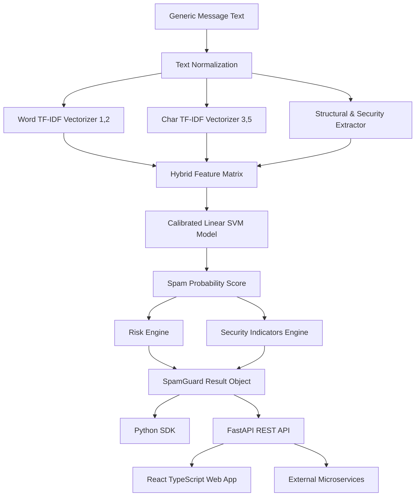

# SpamGuard AI Architecture

SpamGuard AI is designed with strict layer separation:

## Layers

1. **ML Engine Layer (`spamguard/`)**: Pure Python/scikit-learn NLP feature extraction, text normalization, and Platt-scaled SVM probability inference.
2. **REST Service Layer (`backend/`)**: FastAPI HTTP endpoints exposing `/api/v1/predict`, `/api/v1/predict/batch`, and `/api/v1/model`.
3. **Web Client Layer (`frontend/`)**: Vite + React + TypeScript + Tailwind CSS user interface communicating exclusively via HTTP API.
